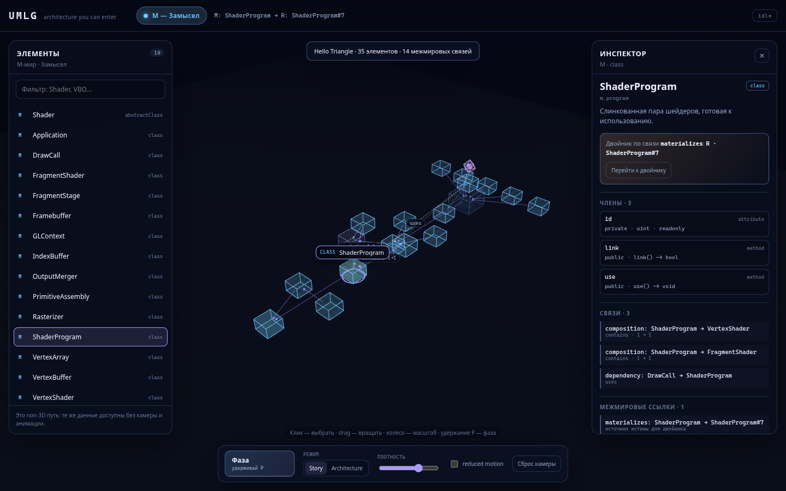
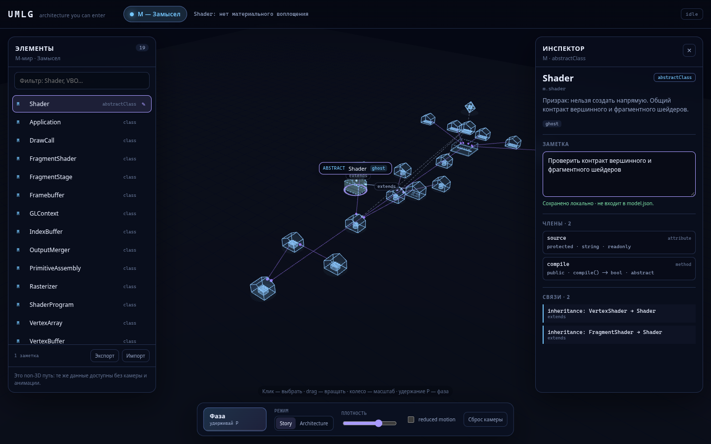

# Viewer

Вьюер — референсная реализация UMLG. В v0.1 это **web-приложение**, а не Godot-плагин: GitHub, ссылки, «открыл и посмотрел», кроссплатформенность.

Статус: **V0–V2 реализованы** на примере `Hello Triangle`. V3+ (NPC, runtime-метрики, WebXR) ещё нет.




## Быстрый старт

```bash
cd viewer
npm ci
npm run dev
```

Открой `http://localhost:5173/`. Модель и схемы копируются из `examples/` и `schema/` в `viewer/public/` скриптом `predev`.

Production-сборка:

```bash
cd viewer
npm run build
npm run preview
```

`npm run build` = `tsc --noEmit && vite build`; ошибки типов блокируют сборку.

Другой пример можно открыть параметрами URL:

```text
http://localhost:5173/?model=examples/hello-triangle/model.json&layout=examples/hello-triangle/layout.json
```

`layout` можно не указывать — он выводится из пути к `model.json`. Путь должен быть доступен внутри `viewer/public/`.

## Управление

| Действие | Что делает |
|---|---|
| клик по элементу или строке списка | выбирает элемент, показывает данные в инспекторе |
| drag / колесо | вращение и масштаб камеры |
| удержание `P` или кнопки «Фаза» | фазовый переход M ↔ R |
| `Tab` | обычная клавиатурная навигация; переход не перехватывает |
| Story / Architecture | Story показывает подписи только у выбранного; Architecture — все подписи и связи |
| Тема (Industrial / Minimal / Tactile) | переключение между `industrial-v1`, резервной `minimal-v0` и светлой студией `tactile-minimal-v1` |
| GPU Profile | включение/отключение доменного профиля `graphics-gpu` с безопасным фолбэком на Core; у каждой темы свой вариант профиля |
| Плотность | прозрачность подписей и линий связей |
| reduced motion | убирает анимацию перехода, мир меняется сразу |
| Сброс камеры | возвращает камеру из `layout.json` |
| «Перейти к двойнику» | переход в другой мир с выбором парного элемента; камера центрируется на нём |
| «Заметка» в инспекторе | личная пометка к элементу; сохраняется в браузере |
| «Экспорт» / «Импорт» под списком | выгрузка и загрузка заметок в JSON |
| «Edit» в шапке | редактор `model.json` и `layout.json`: проверка, применение, скачивание |

## Темы

Темы изолированы в `viewer/src/themes/` и переключаются в HUD без перезагрузки:

- `industrial-v1` — индустриальный конвейер Satisfactory: голограммы в M, PBR-агрегаты в R;
- `minimal-v0` — резервные простые силуэты для отладки и слабых устройств;
- `tactile-minimal-v1` — светлая студия Braun / Teenage Engineering: матовый пластик, анодированный алюминий, матовое стекло, нейтральный свет и спокойная индикация.

Каждая тема поставляет свой вариант профиля `graphics-gpu`. Если выключить `GPU Profile`, сущности с префиксом `gpu:` рендерятся базовыми примитивами Core и не вызывают ошибок. Выбор темы и профиля сохраняется при переключении в пределах сессии.

## Выделение

Выделение — это текущий фокус, а не семантическое утверждение. Выбранный элемент получает:

- кольцо под объектом и чуть больший масштаб;
- более яркий emissive/opacity и локальный источник света;
- подсвеченные связи с подписями;
- строку в non-3D списке и данные в инспекторе.

Цвет и свет здесь означают только «сюда смотрит пользователь». Тип, `materializes`, `drift` и инварианты по-прежнему читаются из модели, а не из подсветки.

## Заметки



Заметки — viewer-local слой поверх модели. Они **не входят в `model.json` и `layout.json`**, не меняют семантику и не являются источником истины.

- В инспекторе у выбранного элемента есть поле «Заметка»; текст сохраняется автоматически.
- Элементы с заметкой отмечены карандашом в списке, счётчик — под списком.
- Хранение: `localStorage`, ключ `umlg:notes:<modelId>`, привязка к стабильному `elementId`.
- Пустая заметка удаляется; если заметок нет, ключ тоже удаляется.
- Если `localStorage` недоступен, вьюер продолжает работать, а поле сообщает об ошибке сохранения.
- «Экспорт» скачивает `hello-triangle-notes.json`:

  ```json
  {
    "notesVersion": "0.1",
    "modelId": "hello-triangle",
    "notes": [{ "elementId": "m.program", "text": "…", "updatedAt": "2026-11-15T…" }]
  }
  ```

- «Импорт» сливает файл с локальными заметками: совпавшие `elementId` обновляются, остальные сохраняются.
- Файл для другой модели отклоняется с ошибкой — заметки не переезжают между `modelId` молча.

Заметки живут только в текущем браузере. Очистка site data их удаляет; для переноса используй экспорт/импорт. Для командной работы заметки не подходят — это личный черновик, а не артефакт модели.

## Редактор модели

Кнопка «Edit» в шапке открывает панель с вкладками **Model** и **Layout**. В каждой — текстовое поле с текущим JSON в читаемом виде (отступы 2 пробела). Кнопки:

| Кнопка | Что делает |
|---|---|
| «Проверить» | запускает те же AJV-схемы draft 2020-12 и семантические проверки, что и загрузка модели; показывает ошибки и предупреждения списком |
| «Применить» | доступна только после проверки без ошибок; заменяет модель и раскладку в памяти, перестраивает сцену, список и инспектор и применяет камеру из `layout.json` |
| «Скачать model.json» / «Скачать layout.json» | скачивает текст текущего черновика как `<modelId>-model.json` / `<modelId>-layout.json` |
| «Закрыть» | закрывает панель и возвращает фокус кнопке «Edit» |

Предупреждения (`warning`) не блокируют применение, ошибки — блокируют. Некорректный JSON показывается явным сообщением: сцена остаётся прежней, пустой она не становится. При применении сохраняется текущий мир, если он есть в новой модели, иначе открывается M; выделение сохраняется, только если его элемент есть в этом мире. Камера сбрасывается на камеру применённой раскладки — правка `camera` в Layout сразу видна на сцене.

Редактор **не пишет файлы на диск** и не сохраняет черновик между перезагрузками. Если черновик меняет `model.id`, после применения активные заметки переключаются на новое пространство `umlg:notes:<modelId>`; прежние записи остаются в браузере и не удаляются. Панель модальная (`aria-modal="true"`): `Tab` и `Shift+Tab` циклически проходят по фокусируемым элементам внутри неё, `Escape` закрывает её и возвращает фокус кнопке «Edit». Стрелки переключают вкладки; обычный порядок `Tab` внутри панели не меняется. Поля и кнопки подписаны, сообщения об ошибках доступны через `role="alert"`.

Фазовый переход следует [`../spec/04-transitions.md`](../spec/04-transitions.md):

1. `arming` — 200 мс удержания;
2. `intent` — 150 мс;
3. `phase` — 550 мс; мир меняется в середине, пока вуаль непрозрачна;
4. `arrival` — 300 мс;
5. `cooldown` — 500 мс.

Другой мир не рендерится ни в один момент: в сцене всегда ровно одна группа `world-M` или `world-R`.

## Что реализовано

- загрузка `model.json` + `layout.json` по URL;
- валидация AJV по тем же схемам, что в CI, плюс семантический валидатор на TypeScript;
- M-мир: классы, абстрактный `Shader` с dashed-контуром, компоненты, концепт `GLState`, связи и инварианты;
- R-мир: объекты, ресурсы, стадии конвейера, команда, акторы CPU/GPU, анимированный поток;
- инспектор: члены, связи, межмировые ссылки, инварианты, провенанс;
- HUD мира, выбранного элемента и двойника (`M: ShaderProgram → R: ShaderProgram#7`);
- non-3D путь: список элементов с фильтром, доступный без камеры и анимации;
- личные заметки к элементам: локальное хранение, маркеры в списке, экспорт/импорт JSON;
- редактор `model.json` / `layout.json`: проверка, применение к сцене и скачивание черновика;
- ошибки валидации показываются экраном с путями и сообщениями, а не молчаливым пустым полем;
- адаптивная раскладка для узких экранов.

## Формы элементов

Тип читается силуэтом — как здания в RTS: пользователь узнаёт объект до чтения подписи. Формы заданы в [`../spec/03-visual-grammar.md`](../spec/03-visual-grammar.md) и строятся кодом, а не берутся из `layout.json`.

| Вид | Форма |
|---|---|
| `class` | стеклянная витрина с чётким контуром и миниатюрой формы R-двойника внутри |
| `abstractClass` | та же витрина с разомкнутым пунктирным контуром, без макета |
| `interface` | шестиугольный порт со сквозным отверстием |
| `component` | платформа с угловыми стойками и миниатюрами частей |
| `concept` | октаэдр с внутренней решёткой и орбитой |
| `object` | монолит-модуль с утопленной панелью, светящимся швом и линзой |
| `resource` | стойка памяти: плиты на рейках, индикаторные полосы |
| `process` | вертикальное кольцо вокруг гранёного ядра |
| `stage` | направляющий канал с кольцами и стрелкой потока |
| `command` | гранёный осколок-сигнал с воротником |
| `actor` | гироскопический пульт: два кольца вокруг ядра |

Внутри M-класса стоит миниатюра формы его R-двойника по `materializes`: после перехода она становится solid, а не заменяется другой формой. Класс без двойника показывает пустой пунктирный постамент. У `component` на настиле стоят миниатюры содержащихся или развёрнутых частей. M-превью намеренно почти wireframe: читаются контур и акценты, а не поверхности.

Цвет принадлежит миру: M — холодный, R — тёплый. Различие видов не зависит от цвета, его несёт силуэт. Размеры подобраны так, чтобы силуэт читался, но объекты не заполняли сцену целиком.

## Рендер

- `MeshPhysicalMaterial` с clearcoat для стекла M и металла R;
- нейтральная environment map (`RoomEnvironment` + PMREM), чтобы PBR-материалы имели отражения;
- ACES filmic tone mapping, bloom, GTAO (контактные тени) и градиентный фон;
- CSS-виньетка поверх сцены для глубины;
- тип кодируется геометрией, а не цветом: цвет — только мир и состояние.

GTAO и bloom заметно нагружают software-рендеринг (headless Chrome без GPU); на реальной видеокарте сцена идёт плавно.

## Слои

```text
viewer/src/
├── core/          # модель, схемы, семантика; не знает о three.js и DOM
│   ├── types.ts
│   ├── validate.ts
│   ├── model.ts
│   ├── notes.ts
│   ├── draft.ts
│   └── load.ts
├── scene/         # модель -> three.js: сцена, визуалы, связи, палитра
│   ├── SceneManager.ts
│   ├── visuals.ts
│   ├── relations.ts
│   └── palette.ts
├── transition/    # фазы, ввод, вуаль
│   └── TransitionController.ts
├── ui/            # HUD, список, инспектор, контролы, заметки
│   ├── ViewerUI.ts
│   └── NotesStore.ts
├── main.ts        # связывание слоёв и requestAnimationFrame
└── style.css
```

| Слой | Отвечает за | Не знает о |
|---|---|---|
| `core` | загрузка, валидация, мир, связи, двойники | three.js, DOM |
| `scene` | преобразование модели в узлы сцены | семантике связей |
| `transition` | фазы, тайминги, reduced motion | конкретной модели |
| `ui` | HUD, список, инспектор | внутренностях рендера |

Ключевое правило: **Core не зависит от рендерера.** Godot/Babylon/свой Vulkan-бэкенд должны иметь возможность использовать тот же Core.

## Проверка

```bash
cd viewer
npm run build          # типы + production bundle
npm test               # unit-тесты core и заметок

cd ..
make validate          # JSON, AJV, семантика, тесты, ссылки
```

Ручной сценарий смоук-теста:

1. открыть стартовую страницу — M-мир, 19 элементов в списке, ошибок в консоли нет;
2. выбрать `ShaderProgram` — инспектор показывает члены, связи и двойника `ShaderProgram#7`;
3. удержать `P` — после вуали открывается R-мир, выбран тот же двойник;
4. нажать «Перейти к двойнику» — возврат в M-мир с выбранным `ShaderProgram`;
5. включить `reduced motion` — переход без анимации;
6. включить Architecture — появляются все подписи и связи;
7. написать заметку к элементу, обновить страницу — текст и карандаш в списке на месте;
8. экспортировать заметки, импортировать файл обратно — счётчик и текст совпадают;
9. сузить окно — список и инспектор остаются доступны;
10. нажать «Edit» — обе вкладки заполнены JSON, фокус внутри панели, `Escape` возвращает фокус на кнопку;
11. испортить JSON, нажать «Проверить» — ошибка видна, «Применить» недоступна, сцена не пуста;
12. исправить JSON, изменить имя элемента, проверить и применить — список и инспектор обновились, мир сохранился.

Скриншоты сделаны headless Chrome с `--enable-unsafe-swiftshader`; отдельный screenshot-скрипт в репозиторий не входит, чтобы не тянуть puppeteer в зависимости вьюера.

## Ограничения

- NPC rule engine (V3), runtime-метрики и drift (V4), WebXR (V5) не реализованы.
- Architecture-режим на плотных раскладках может перекрывать подписи; это осознанный компромисс V2.
- Камера не сохраняется между сессиями.
- Заметки хранятся только в `localStorage` текущего браузера; синхронизации и командной работы нет.
- Поддерживаются только миры `M` и `R` из схемы v0.1.
- Редактор меняет только состояние вкладки: серверной записи и сохранения файлов нет.

## Технологии

- **three.js** — рендер, материалы, CSS2D-подписи.
- **TypeScript** — Core и UI.
- **Vite** — сборка.
- **AJV** — валидация схем (та же, что в CI).
- **WebXR** — опционально, после базового MVP.

Почему не Godot в v0.1:

- web лучше для публикации и обратной связи;
- не нужен экспорт под три платформы;
- проще тестировать на 5–8 людях;
- Core всё равно engine-agnostic, Godot-плагин — следующий milestone.

Почему не «чистый Vulkan»:

- Vulkan — API рендеринга, а не движок;
- пришлось бы писать окно, ввод, камеру, пикинг, 3D-текст, UI, загрузку ассетов, LOD;
- это отдельный проект, который съест время у языка.

## Этапы

| Этап | Результат | Статус |
|---|---|---|
| V0 | загрузка JSON, статичная сцена M-мира, инспектор | готово |
| V1 | R-мир и фазовый переход | готово |
| V2 | HUD двойника, Story/Architecture, reduced motion | готово |
| V3 | NPC rule engine | запланировано |
| V4 | runtime-метрики и drift | запланировано |
| V5 | WebXR | запланировано |

## Ограничения дизайна

- Никакой генерации сцены «руками под пример»: всё из модели.
- Никакой семантики в шейдерах/материалах.
- Никаких скрытых связей: если линия не читается из модели, её нет.
